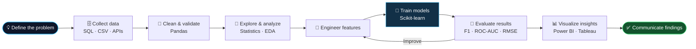

<!--
  ╔══════════════════════════════════════════════════════════════╗
  ║  SAJAL PANCHAL • DATA SCIENCE / AI / ANALYTICS               ║
  ║  GitHub Profile README — customize links and project repos   ║
  ╚══════════════════════════════════════════════════════════════╝
-->
--------

--------
<div align="center">

<a href="https://git.io/typing-svg">
  
</a>

<br/>

<a href="https://linkedin.com/in/sajal-panchal-742030316"></a>
<a href="https://kaggle.com/sajalpanchal"></a>
<a href="https://datascienceportfol.io/panchalsajal70"></a>
<a href="mailto:panchal.sajal70@gmail.com"></a>

<br/><br/>


</div>

---

## `01 // SYSTEM_PROFILE` — About the Developer


Hey! I'm **Sajal Panchal**, a Computer Science student interested in **Data Science, Machine Learning, Artificial Intelligence, and Analytics**. I enjoy exploring datasets, finding meaningful patterns, building predictive workflows, and presenting results through clear visualizations.

- 🎓 **Education:** B.Tech in Computer Science & Engineering, MDU Rohtak (2023–2027)
- 🧠 **Further learning:** Full Stack Data Science & AI certificate program, IIT Guwahati *(ongoing)*
- 🔎 **Core interests:** Predictive modeling, exploratory data analysis, business intelligence, and GenAI
- 📊 **Analytics:** SQL, Python, Power BI, Tableau, and Excel
- 🌱 **Currently exploring:** NLP, model evaluation, MLflow, and cloud-based AI workflows
- 🤝 **Open to:** Data Science, AI/ML, and Data Analytics internships and entry-level opportunities

<br clear="right"/>

> **My approach:** Understand the problem → prepare reliable data → analyze and model → communicate insights.

---

## `02 // TECHNOLOGY_STACK` — Engineering Toolkit

<div align="center">


### `LANGUAGE_LAYER` // Programming & Querying
<a href="https://www.python.org/"></a>
<a href="https://www.mysql.com/"></a>
<a href="https://isocpp.org/"></a>
<a href="https://openjdk.org/"></a>
<a href="https://developer.mozilla.org/en-US/docs/Web/HTML"></a>
<a href="https://developer.mozilla.org/en-US/docs/Web/CSS"></a>

### `ANALYTICS_LAYER` // Data Processing & Visualization
<a href="https://pandas.pydata.org/"></a>
<a href="https://numpy.org/"></a>
<a href="https://matplotlib.org/"></a>
<a href="https://seaborn.pydata.org/"></a>
<a href="https://plotly.com/"></a>
<a href="https://powerbi.microsoft.com/"></a>
<a href="https://www.tableau.com/"></a>
<a href="https://www.microsoft.com/microsoft-365/excel"></a>

### `INTELLIGENCE_LAYER` // Machine Learning & AI
<a href="https://scikit-learn.org/"></a>
<a href="https://www.tensorflow.org/"></a>
<a href="https://pytorch.org/"></a>
<a href="https://scipy.org/"></a>
<a href="https://mlflow.org/"></a>

### `INFRASTRUCTURE_LAYER` // Databases, Cloud & Dev Tools
<a href="https://www.postgresql.org/"></a>
<a href="https://www.mongodb.com/"></a>
<a href="https://azure.microsoft.com/"></a>
<a href="https://www.oracle.com/cloud/"></a>
<a href="https://git-scm.com/"></a>
<a href="https://github.com/Sajal-Panchal"></a>
<a href="https://jupyter.org/"></a>
<a href="https://colab.research.google.com/"></a>
<a href="https://code.visualstudio.com/"></a>

</div>

<details>
<summary><b>🧩 Skills in practice — expand for focus areas</b></summary>

| Focus area | Topics and techniques |
|---|---|
| Data preparation | Cleaning, missing values, transformations, joins, and feature preparation |
| SQL & databases | Filtering, joins, grouping, aggregations, subqueries, and window functions |
| Exploratory analysis | Descriptive statistics, correlation, trend analysis, and visualization |
| Machine learning | Regression, classification, preprocessing pipelines, cross-validation, and hyperparameter tuning |
| Model evaluation | Classification reports, F1-score, ROC-AUC, RMSE, and model comparison |
| Business intelligence | KPI design, dashboarding, and communicating findings to stakeholders |
| AI learning | Deep learning fundamentals, NLP, GenAI concepts, and prompt design |
| Workflow tools | Git, Jupyter, Colab, and MLflow exploration |

</details>

---

## `03 // DATA_PIPELINE` — From Raw Data to Intelligence



<details>
<summary><b>⚙️ Example: reusable machine-learning pipeline</b></summary>

This example demonstrates a common structure for a tabular classification task. Replace `data.csv` and `target` with the appropriate dataset and target column before running.

```python
import pandas as pd

from sklearn.compose import ColumnTransformer
from sklearn.ensemble import RandomForestClassifier
from sklearn.metrics import classification_report, roc_auc_score
from sklearn.model_selection import GridSearchCV, train_test_split
from sklearn.pipeline import Pipeline
from sklearn.preprocessing import OneHotEncoder, StandardScaler

df = pd.read_csv("data.csv")
X = df.drop(columns="target")
y = df["target"]

X_train, X_test, y_train, y_test = train_test_split(
    X, y, test_size=0.20, stratify=y, random_state=42
)

numeric_features = X.select_dtypes(include="number").columns
categorical_features = X.select_dtypes(exclude="number").columns

preprocessor = ColumnTransformer([
    ("numeric", StandardScaler(), numeric_features),
    ("categorical", OneHotEncoder(handle_unknown="ignore"), categorical_features),
])

pipeline = Pipeline([
    ("preprocessor", preprocessor),
    ("model", RandomForestClassifier(random_state=42)),
])

search = GridSearchCV(
    pipeline,
    {
        "model__n_estimators": [200, 400],
        "model__max_depth": [None, 10, 20],
    },
    scoring="f1",
    cv=5,
    n_jobs=-1,
)

search.fit(X_train, y_train)
predictions = search.predict(X_test)

print("Best parameters:", search.best_params_)
print(classification_report(y_test, predictions))

if y.nunique() == 2:
    probabilities = search.predict_proba(X_test)[:, 1]
    print("ROC-AUC:", roc_auc_score(y_test, probabilities))
```

</details>

<details>
<summary><b>🗃️ Example: SQL ranking and running totals</b></summary>

```sql
-- Rank products within each category by revenue
WITH product_revenue AS (
    SELECT
        p.category,
        p.name AS product,
        SUM(o.qty * o.price) AS revenue
    FROM orders AS o
    JOIN products AS p
        ON p.id = o.product_id
    GROUP BY p.category, p.name
),
ranked_products AS (
    SELECT
        category,
        product,
        revenue,
        RANK() OVER (
            PARTITION BY category
            ORDER BY revenue DESC
        ) AS revenue_rank,
        SUM(revenue) OVER (
            PARTITION BY category
            ORDER BY revenue DESC
            ROWS BETWEEN UNBOUNDED PRECEDING AND CURRENT ROW
        ) AS running_revenue
    FROM product_revenue
)
SELECT *
FROM ranked_products
WHERE revenue_rank <= 3;
```

</details>

---

## `04 // PROJECT_MODULES` — Applied Data & AI Projects

> Project summaries below describe the work and learning areas. Add the exact repository links in place of the placeholders when each project has its own public repository.

<table>
  <tr>
    <td width="50%" valign="top">
      
      <h3>🎧 Spotify Music Analytics</h3>
      
      
      <p>Explore track popularity, chart positions, song duration, album information, and release trends through a music analytics dashboard.</p>
      <b>Focus:</b> KPI measures, comparisons, trend discovery, and visual storytelling.
    </td>
    <td width="50%" valign="top">
      
      <h3>📉 Customer Churn Analysis</h3>
      
      
      
      <p>Analyze customer data to explore churn patterns and potential attrition drivers using data cleaning, exploratory analysis, and visualizations.</p>
      <b>Focus:</b> Data quality, segmentation, patterns, and retention-oriented insights.
    </td>
  </tr>
  <tr>
    <td width="50%" valign="top">
      
      <h3>🤖 Machine Learning Model Development</h3>
      
      
      <p>Developing a structured workflow for tabular ML problems, from preprocessing and feature engineering through training and evaluation.</p>
      <b>Focus:</b> Pipelines, cross-validation, parameter tuning, and evaluation metrics.
    </td>
    <td width="50%" valign="top">
      
      <h3>📊 Data Analytics Simulation</h3>
      
      
      <p>Practice business-focused analysis by organizing datasets, identifying trends, and presenting results through dashboard-led storytelling.</p>
      <b>Focus:</b> Business questions, trends, dashboards, and recommendations.
    </td>
  </tr>
</table>

<details>
<summary><b>🏷️ AI data-labeling workflow</b></summary>

Practice experience with labeling support data for intent, sentiment, and personally identifiable information (PII), including peer review and edge-case checks for consistency.

</details>

---

## `05 // EXPERIENCE_LOG` — Simulations & Applied Learning

| Period | Program / role | Focus |
|---|---|---|
| Dec 2025 – Jan 2026 | **Forage — Data Labeling job simulation** | Intent, sentiment, and PII labeling; peer review and edge-case consistency |
| Sep 2025 – Nov 2025 | **Deloitte — Data Analytics job simulation** | Excel-based trend analysis and Tableau dashboard storytelling |
| Jun 2025 – Sep 2025 | **Tata — Data Visualization job simulation** | Executive dashboards and framing analytical questions around business goals |

*The roles listed above are job simulations, not conventional employment positions.*

---

## `06 // CREDENTIALS` — Education & Certifications

<div align="center">

<a href="https://www.oracle.com/cloud/"></a>
<a href="https://www.oracle.com/business-analytics/analytics-cloud/"></a>
<a href="https://www.hp.com/"></a>
<a href="https://www.netacad.com/"></a>
<a href="https://www.linkedin.com/learning/"></a>
<a href="https://www.iitg.ac.in/"></a>
<a href="https://www.mdurohtak.ac.in/"></a>

</div>

---

## `07 // REPOSITORY_METRICS` — GitHub Analytics

<div align="center">


</div>

### `VISUAL_TELEMETRY` // Contribution Animation

> To display this animation, configure the GitHub Actions workflow that generates `github-snake.svg` and publishes it to the `output` branch.

<div align="center">
  <picture>
    <source media="(prefers-color-scheme: dark)" srcset="https://raw.githubusercontent.com/Sajal-Panchal/Sajal-Panchal/output/github-snake-dark.svg"/>
    <source media="(prefers-color-scheme: light)" srcset="https://raw.githubusercontent.com/Sajal-Panchal/Sajal-Panchal/output/github-snake.svg"/>
    
  </picture>
</div>

---

## `08 // ACTIVE_BUILDS` — Current Research & Development

- 🧪 Practicing machine-learning workflows with Scikit-learn: preprocessing, feature engineering, cross-validation, and tuning.
- 🎓 Continuing to learn Full Stack Data Science & AI.
- 🧠 Exploring NLP, Generative AI, prompt engineering, and MLOps concepts.
- 📈 Improving my ability to turn analytical results into clear dashboards and useful recommendations.
- 🚀 Looking for opportunities to learn, collaborate, and contribute to Data Science, AI/ML, and Analytics projects.

---

## `09 // NETWORK_INTERFACE` — Connect & Collaborate

<div align="center">

<a href="https://linkedin.com/in/sajal-panchal-742030316"></a>
<a href="https://kaggle.com/sajalpanchal"></a>
<a href="https://datascienceportfol.io/panchalsajal70"></a>
<a href="mailto:panchal.sajal70@gmail.com"></a>

<br/><br/>

**Thanks for visiting my profile!** If you find a project useful, feel free to ⭐ the repository or connect with me.


</div>


